  

<h1 align="center">VialSynth 1.0</h1>

<em>A wavetable synthesizer with spectral warping, an unlimited effects rack and point modulation. Free and open source (GPLv3).</em>

VialSynth is a wavetable synthesizer plugin (VST3). It has three wavetable oscillators and a sample oscillator, two filters, a deep modulation system and an effects rack, and it grew out of the same code base as [VialFX](https://github.com/asanielofficial/vialfx).

## Changelog

**New in 1.0** (the first release)

- **Three wavetable oscillators and a sample oscillator,** each with its own wavetable editor, 3D display, unison, phase and distortion controls.
- **Spectral morph modes on every oscillator.** Vocode, Formant Scale, Harmonic and Inharmonic Stretch, Smear, Low and High Pass, Phase Disperse and more, drawn live in the oscillator display, including when the controls are modulated.
  - **Random Amplitudes** has **Mix** and **Shuffle** knobs and a dice that re-rolls the pattern. The dice is a parameter like any other: right-click it, automate it or modulate it from the matrix, and every time its value crosses the middle the pattern is re-rolled.
- **Two filters and the Other filters.** Besides the classic models, the Other category adds **Band Reject**, **All-Pass**, **Metal Comb**, **Metal Reverb**, **Disperser** and **Custom**. In Custom you draw three response curves A, B and C, the three positions of the blend slider are the three frames, and a pencil button on the display switches to editing. **Drive** soft-clips the input ahead of the filter.
- **Effects rack.** Chorus, Compressor, Delay, Distortion, Equalizer, Filter, Flanger, Phaser, Reverb and more, added in any order and as many times as you like. Right-click a row to duplicate, minimize or remove an effect, and select several effects by dragging over rows. Duplicating an effect keeps its modulation.
- **Big modulation system.** 32 LFOs, 32 envelopes, 16 random LFOs and 8 macros, plus MIDI sources. The matrix is organised in sections and every dropdown can be searched by typing. Parameters in the oscillator popup windows show their modulation too.
- **Modulate the points of drawn lines.** Drag a modulation source over an LFO shape or a spectral curve and every point shows an X and a Y target.
- **Host automation slots.** 64 slots can be assigned to any parameter, so a DAW can automate whatever you pick.
- **Output DC blocker,** so patches that stack many compressors no longer carry a DC offset that stops them from playing.
- **Skin Editor** with bins, gradients, bevels and glow, custom `.vialskin` skins, a new default skin and a **resizable** window.

## Highlights

- **Spectral warping you can see.** The oscillator display follows every warp and morph control, modulation included.
- **Everything is modulatable.** Drag a source onto nearly any control, from the small shuffle knob to the points of a curve.
- **No account, no web service.** VialSynth does not connect to any server.
- **Free and open source,** with the source and the licence in the repository.

## Downloads

| Platform | File |
| --- | --- |
| Windows | `VialSynth-1.0-windows-vst3.zip` |
| macOS (Apple Silicon and Intel) | `VialSynth-1.0-macos-vst3.zip` |
| Linux | `VialSynth-1.0-linux-vst3.zip` |

Unzip and copy `VialSynth.vst3` to your system VST3 folder, then rescan plugins in your DAW:

- **Windows:** `C:\Program Files\Common Files\VST3`
- **macOS:** `/Library/Audio/Plug-Ins/VST3` (or `~/Library/Audio/Plug-Ins/VST3`)
- **Linux:** `~/.vst3`

> **Note:** the builds are unsigned. Windows may show a SmartScreen warning (More info > Run anyway). On macOS, right-click the plugin and choose Open the first time, or remove the quarantine flag with `xattr -dr com.apple.quarantine VialSynth.vst3`.

## Licence

GPLv3. VialSynth is built from GPLv3 source code and does not connect to any web service. See the README and NOTICE.md for details.
