  

<h1 align="center">VialSynth 1.1</h1>

<em>A wavetable synthesizer with spectral warping, an unlimited effects rack and point modulation. Free and open source (GPLv3).</em>

VialSynth is a wavetable synthesizer plugin (VST3). It has three wavetable oscillators and a sample oscillator, two filters, a deep modulation system and an effects rack, and it grew out of the same code base as [VialFX](https://github.com/asanielofficial/vialfx).

## Changelog

**New in 1.1**

- **Random Amplitudes in the Morph effect works like the oscillator's.** The amount knob has a much wider range, the pattern holds still while it moves, and **Shuffle** is what changes the pattern.
  - **Mix, the dice and Shuffle** share one row with labels under the knobs. Both knobs are the same size.
  - **The dice is a parameter in the effect too.** Right-click it, automate it or modulate it from the matrix, and every time its value crosses the middle the pattern is re-rolled.
- **Installers for Windows and macOS** (`.exe` and `.pkg`), next to the zip files.
- **The VST3 now declares one stereo output,** so every host and validator can restore its default layout.
- **Fixed a build error on macOS** that stopped the first release from compiling there.

**From 1.0:** three wavetable oscillators and a sample oscillator with spectral morph modes you can see, two filters with the Other and Custom filters, an effects rack, 32 LFOs, 32 envelopes, 16 random LFOs and 8 macros, point modulation, 64 host automation slots, a skin editor and a resizable window.

## Highlights

- **Spectral warping you can see.** The oscillator display follows every warp and morph control, modulation included.
- **Everything is modulatable.** Drag a source onto nearly any control, from the small shuffle knob to the points of a curve.
- **No account, no web service.** VialSynth does not connect to any server.
- **Free and open source,** with the source and the licence in the repository.

## Downloads

| Platform | File |
| --- | --- |
| Windows | `VialSynth-1.1-Windows-Setup.exe` (installer) or `VialSynth-1.1-windows-vst3.zip` |
| macOS (Apple Silicon and Intel) | `VialSynth-1.1-macOS.pkg` (installer) or `VialSynth-1.1-macos-vst3.zip` |
| Linux | `VialSynth-1.1-linux-vst3.zip` |

The installers put VialSynth in the standard system VST3 folder. After installing, rescan plugins in your DAW. For the zips, unzip and copy `VialSynth.vst3` to your system VST3 folder instead:

- **Windows:** `C:\Program Files\Common Files\VST3`
- **macOS:** `/Library/Audio/Plug-Ins/VST3` (or `~/Library/Audio/Plug-Ins/VST3`)
- **Linux:** `~/.vst3`

> **Note:** the builds are unsigned. Windows may show a SmartScreen warning (More info > Run anyway). On macOS, right-click the installer (or the plugin) and choose Open the first time, or remove the quarantine flag with `xattr -dr com.apple.quarantine VialSynth.vst3`.

## Licence

GPLv3. VialSynth is built from GPLv3 source code and does not connect to any web service. See the README and NOTICE.md for details.

## Acknowledgements

**Matt Tytel.** VialSynth would not exist without him. It is built on the open-source synthesizer code he wrote and released under the GPLv3. His work on the audio engine, the modulation system and the interface gave this project a foundation far beyond what we could have built from scratch. Thank you for sharing that work openly so that others can learn from it and build on it. VialSynth is an independent project and is not affiliated with or endorsed by him.

**-LightningPig** made the art for the Vial plugins, including the logo you see at the top of this page. Thank you for giving the plugins their look.

**Every tester.** Thank you to everyone who installed early builds, reported bugs, sent screenshots and told us what felt wrong. Much of what is in 1.0 exists because of your feedback.
