  

<h1 align="center">VialSynth 1.3</h1>

<em>A wavetable synthesizer with spectral warping, an unlimited effects rack and point modulation. Free and open source (GPLv3).</em>

VialSynth is a wavetable synthesizer plugin and standalone app (VST3, CLAP, AU and LV2). It has three wavetable oscillators and a sample oscillator, two filters, a deep modulation system and an effects rack, and it grew out of the same code base as [VialFX](https://github.com/asanielofficial/vialfx).

## Changelog

**New in 1.2**

- **A standalone app for Windows, macOS and Linux.** Run VialSynth on its own, with its own audio and MIDI settings and a computer-keyboard piano. No DAW needed.
- **New plugin formats.** CLAP for Windows, macOS and Linux, an Audio Unit (AU) for macOS and LV2 for Linux, next to the VST3.
- **Installers pick the formats.** The Windows installer lets you choose VST3 and CLAP; the macOS installer lets you choose VST3, CLAP and AU.

**From 1.2:** the Resonator effect (follows your notes, pitch bend and MPE, and microtonal tunings), wavetable menus in the Morph effect's table editor, knobs that redraw correctly when resized, and a hover highlight on the dice.

**From 1.1:** Random Amplitudes in the Morph effect matches the oscillator's, the dice is automatable and modulatable, installers for Windows and macOS, and a single stereo output for every host.

**From 1.0:** three wavetable oscillators and a sample oscillator with spectral morph modes you can see, two filters with the Other and Custom filters, an effects rack, 32 LFOs, 32 envelopes, 16 random LFOs and 8 macros, point modulation, 64 host automation slots, a skin editor and a resizable window.

## Highlights

- **Spectral warping you can see.** The oscillator display follows every warp and morph control, modulation included.
- **Everything is modulatable.** Drag a source onto nearly any control, from the small shuffle knob to the points of a curve.
- **No account, no web service.** VialSynth does not connect to any server.
- **Free and open source,** with the source and the licence in the repository.

## Downloads

| Platform | Files |
| --- | --- |
| Windows | `VialSynth-1.3-Windows-Setup.exe` (installer for VST3 and CLAP), or the zips `VialSynth-1.3-windows-vst3.zip`, `VialSynth-1.3-windows-clap.zip`, `VialSynth-1.3-windows-standalone.zip` |
| macOS (Apple Silicon and Intel) | `VialSynth-1.3-macOS.pkg` (installer for VST3, CLAP and AU), or the zips `VialSynth-1.3-macos-vst3.zip`, `VialSynth-1.3-macos-clap.zip`, `VialSynth-1.3-macos-au.zip`, `VialSynth-1.3-macos-standalone.zip` |
| Linux | `VialSynth-1.3-linux-vst3.zip`, `VialSynth-1.3-linux-clap.zip`, `VialSynth-1.3-linux-lv2.zip`, `VialSynth-1.3-linux-standalone.zip` |

The installers put the plugins in the standard system folders. After installing, rescan plugins in your DAW. For the zips, unzip and copy the plugin to the folder for its format:

| Format | Windows | macOS | Linux |
| --- | --- | --- | --- |
| VST3 | `C:\Program Files\Common Files\VST3` | `/Library/Audio/Plug-Ins/VST3` | `~/.vst3` |
| CLAP | `C:\Program Files\Common Files\CLAP` | `/Library/Audio/Plug-Ins/CLAP` | `~/.clap` |
| AU | | `/Library/Audio/Plug-Ins/Components` | |
| LV2 | | | `~/.lv2` |

The standalone app needs no installation: unzip it and run `VialSynth.exe` (Windows), `VialSynth.app` (macOS) or `VialSynth` (Linux).

> **Note:** the builds are unsigned. Windows may show a SmartScreen warning (More info > Run anyway). On macOS, right-click the installer (or the plugin or app) and choose Open the first time, or remove the quarantine flag with `xattr -dr com.apple.quarantine <the file>`.

## Licence

GPLv3. VialSynth is built from GPLv3 source code and does not connect to any web service. See the README and NOTICE.md for details.

## Acknowledgements

**Matt Tytel.** VialSynth would not exist without him. It is built on the open-source synthesizer code he wrote and released under the GPLv3. His work on the audio engine, the modulation system and the interface gave this project a foundation far beyond what we could have built from scratch. Thank you for sharing that work openly so that others can learn from it and build on it. VialSynth is an independent project and is not affiliated with or endorsed by him.

**-LightningPig** made the art for the Vial plugins, including the logo you see at the top of this page. Thank you for giving the plugins their look.

**Every tester.** Thank you to everyone who installed early builds, reported bugs, sent screenshots and told us what felt wrong. Much of what is in 1.0 exists because of your feedback.
